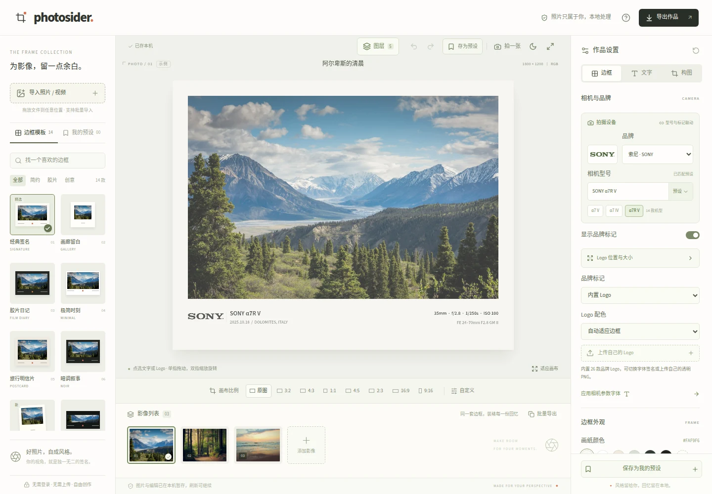
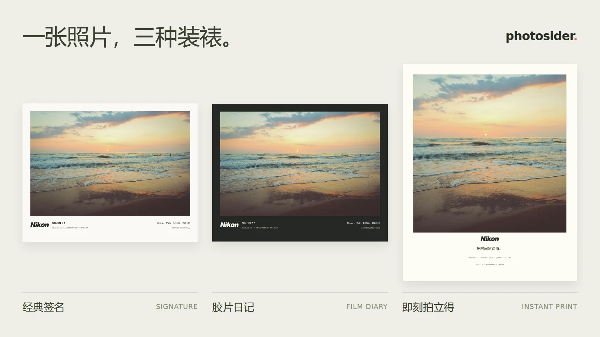
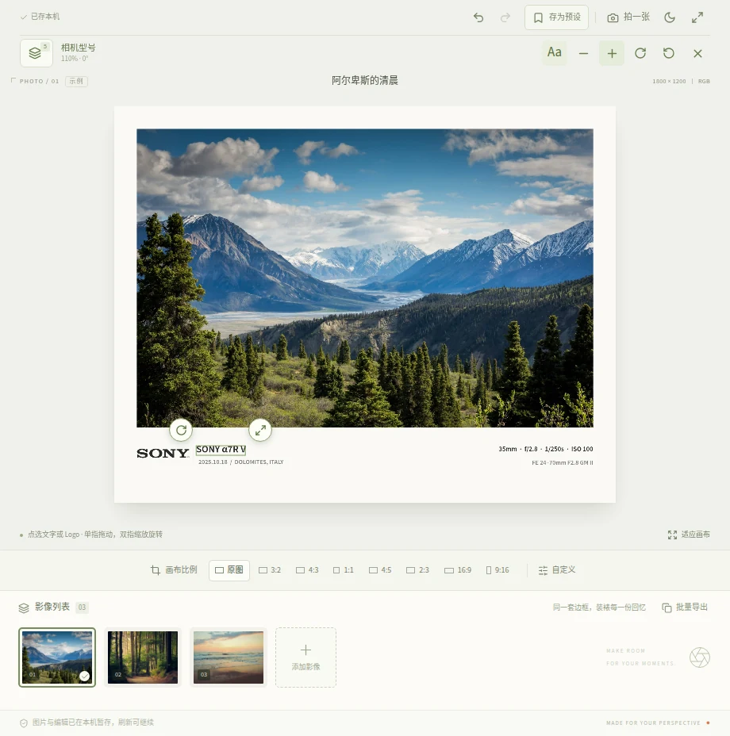
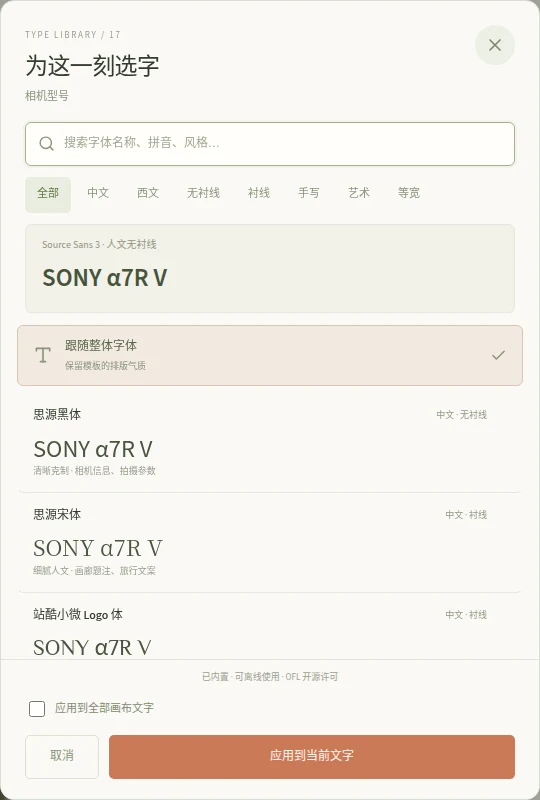
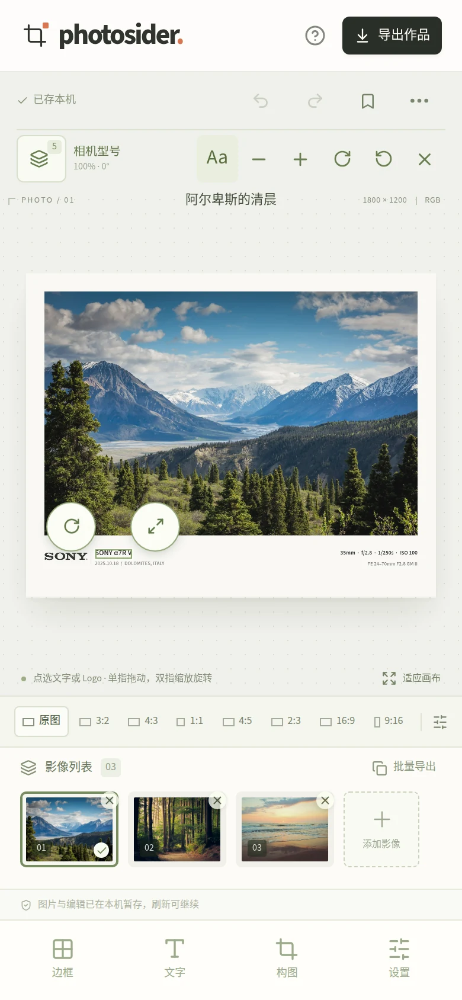
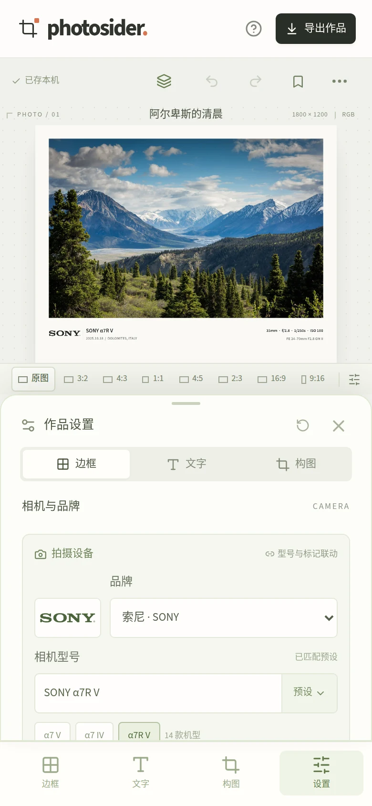

<div align="center">


# Photosider

**给照片留一点余白，把拍摄时的记忆一起装裱。**

一个在浏览器里使用的摄影边框工作室。<br>
14 款边框 · EXIF 自动读取 · 文字与 Logo 直接编辑 · 批量导出 · 本机保存


[在线预览](https://photosider.vercel.app/) · [快速开始](#快速开始) · [作品效果](#给照片选一套合适的边框) · [手机使用](#手机上也能调整)



</div>

---

## 照片拍好了，然后呢

想给照片加一道白边，留住相机型号、焦距和拍摄日期，再配上一句当时的心情。换到下一张，又希望沿用刚才的字体和留白。

Photosider 把这些操作放在同一个工作台里：拖入照片，挑一款边框，拍摄信息自动填好。哪里需要调整，就点选画布上的文字或 Logo。喜欢这个样式，存成预设，下次继续用。

**从导入到成品，照片处理都在你的浏览器里完成。** 不需要注册账户、填写 API Key 或配置处理服务器。

## 快速开始

无需安装，直接打开 **[在线预览](https://photosider.vercel.app/)** 即可体验。

在本机运行需要 **Node.js 22.12+** 和 npm。

```bash
git clone https://github.com/run-bigpig/photosider.git
cd photosider
npm ci
npm run dev
```

打开终端显示的地址，默认为 [localhost:5173](http://localhost:5173)。页面自带三张示例照片，打开就能试；导入自己的照片或视频后，示例列表会被替换。

---

## 给照片选一套合适的边框

同一张照片，换一种装裱，画面的重心也会跟着变化。喜欢干净的留白，可以从“经典签名”开始；想要胶片感，试试深色边框；旅行照片也可以做成明信片或拍立得。

<p align="center"></p>

内置 **14 款版式**，按简约、胶片、创意分类。留白、底色、圆角、阴影和画幅比例都可以继续调整。

<details>
<summary><b>查看全部边框</b></summary>

| 简约     | 胶片       | 创意       |
| -------- | ---------- | ---------- |
| 经典签名 | 胶片日记   | 旅行明信片 |
| 画廊留白 | 35mm 片孔  | 即刻拍立得 |
| 极简时刻 | 幻灯片收藏 | 电影画幅   |
| 暗调叙事 |            | 氛围虚化   |
| 双层卡纸 |            | 远方来信   |
|          |            | 杂志封面   |

</details>

## 文字和 Logo，可以直接上手调整

照片中的机型、镜头、焦距、光圈、快门、ISO、拍摄日期与 GPS 会自动读取，缺少的内容可以手动补上。切换照片时，相机信息和品牌标识也会跟着切换。

点选画布上的文字或 Logo，就能拖动、缩放、旋转；太小的元素可以从“图层”里找。文字的字体、大小和位置都可以单独设置，也能统一应用到整张作品。

<table>
<tr>
<td width="60%" valign="top"></td>
<td width="40%" valign="top"></td>
</tr>
<tr>
<td align="center"><b>点选就能调整</b><br>拖动位置，缩放、旋转；撤销与重做始终留在工具栏</td>
<td align="center"><b>先看字样，再换字体</b><br>支持中文名、拼音与风格搜索，可应用到当前文字或全部文字</td>
</tr>
</table>

内置相机品牌 Logo、中西文字体，也支持上传自己的 Logo。调整满意后点击“存为预设”，留白、字体、颜色和布局就能在下一次创作中复用。**预设只保存样式，不包含照片原文件。**

<details>
<summary><b>常用操作与快捷键</b></summary>

| 操作           | 使用方式                                   |
| -------------- | ------------------------------------------ |
| 导入影像       | 点击“导入照片 / 视频”，或将文件拖进页面    |
| 选择小元素     | 点击“图层”，按名称或内容搜索               |
| 调整文字、Logo | 点选后拖动，使用控制点或顶部工具缩放、旋转 |
| 更换文字字体   | 选中文字，点击顶部的 `Aa`                  |
| 撤销 / 重做    | `Ctrl / ⌘ + Z` / `Ctrl / ⌘ + Shift + Z`    |
| 保存当前风格   | 点击“存为预设”，填写名称                   |
| 批量导出       | 在影像列表中点击“批量导出”                 |

</details>

---

## 手机上也能调整

画布留在上方，模板和设置从底部展开。点选文字或 Logo 后，可以单指拖动，也可以用双指平移、缩放和旋转。拍摄、工作台深浅色切换和全屏预览收在“更多”里。

<table>
<tr>
<td width="50%" align="center"></td>
<td width="50%" align="center"></td>
</tr>
<tr>
<td align="center"><b>在画布上直接编辑</b><br>小屏也能选择图层、换字体、撤销与重做</td>
<td align="center"><b>边调，边看结果</b><br>展开底部面板，画布随可用空间调整</td>
</tr>
</table>

<p align="center"><sub>以上均为实际页面截图。桌面使用三栏工作台，平板折叠设置栏；影像列表在固定区域内滚动。</sub></p>

## 从预览到导出

- **照片**：导出 JPG / PNG，选择尺寸和 JPG 品质；批量照片按当前样式合成，每张保留自己的拍摄信息，打包成 ZIP。
- **打印**：支持 A4、Letter、6 寸相纸，以及方向和边距设置；系统打印窗口可选择打印机或保存为 PDF。
- **视频**：导入后生成缩略图，在本机预览和添加边框，可选择保留音轨；视频单独导出，也能打印当前画面。
- **拍摄**：用摄像头实时预览边框并拍照，关闭拍摄窗口后释放摄像头。

<details>
<summary><b>支持的格式与实际限制</b></summary>

| 项目         | 支持范围                                                                          |
| ------------ | --------------------------------------------------------------------------------- |
| 图片导入     | JPG、PNG、WebP、AVIF 等浏览器可解码格式；单次最多读取 100 个文件                  |
| HEIC / RAW   | HEIC 取决于浏览器与操作系统；不提供 RAW 解码                                      |
| 图片导出     | 1600、2400、4096 px 或原图长边，上限 8192 px；合成文件不保留原始 EXIF             |
| 视频导出     | 使用 Canvas 与 MediaRecorder，最长边最高 1920 px；MP4 / WebM 取决于浏览器编码支持 |
| 视频处理时间 | 按实际时长在本机处理，需保持页面在前台                                            |
| 地点         | 读取已有 GPS 并显示坐标，地点名称可手动填写；不依赖在线地理编码                   |
| 摄像头       | 需要 HTTPS 或 localhost 环境，并由浏览器请求权限                                  |

</details>

---

## 照片保存在什么地方

原始照片、视频和缩略图保存在当前浏览器的 **IndexedDB**，编辑参数与命名预设保存在 **localStorage**。刷新页面，会恢复刚才的项目。

生产版本包含离线缓存。首次完整访问并缓存成功后，可以离线重新打开；支持的浏览器也可将它添加到主屏幕。字体、品牌 Logo 和示例图片随站点一起提供。

> **本机暂存不等于备份。** 清除网站数据、结束无痕会话或浏览器回收存储空间，都可能移除暂存内容。完成的作品请及时导出。

## 构建与部署

```bash
npm run build
npm run preview
```

将生成的 `dist/` 部署到静态网站托管服务的**域名根目录**，无需额外的图片处理后端。

### Vercel 部署

在 Vercel 中导入本仓库即可部署。仓库已包含 `vercel.json`，使用 Vite 预设、`npm ci` 安装依赖、`npm run build` 构建，发布目录为 `dist/`，无需设置环境变量。

连接 GitHub 仓库后，推送到 `main` 可自动更新生产站点。README 配图、测试和调研资料不上传到部署包。

首次连接私有仓库时，需要在 GitHub 的 Vercel App 中授予对应仓库的访问权限。也可以在已登录的环境中运行 `npx vercel --prod` 手动发布。

<details>
<summary><b>子路径部署与技术实现</b></summary>

当前资源地址、Web App Manifest 和 Service Worker 按根目录配置。部署到子路径前，需要同步调整 Vite 的 base、资源引用、Manifest 和缓存路径。

**技术栈**：React 19 · TypeScript · Vite · Canvas 2D · exifr · fflate · lucide-react。

预览与导出共用画面渲染逻辑；项目恢复、字体加载、相机信息和画布元素布局均在浏览器侧完成。

</details>

## 素材与许可

示例照片来自 Unsplash：[山景](https://images.unsplash.com/photo-1464822759023-fed622ff2c3b)、[森林](https://images.unsplash.com/photo-1441974231531-c6227db76b6e)、[海岸](https://images.unsplash.com/photo-1473116763249-2faaef81ccda)。示例中的机型、参数与地点用于展示版式，不代表照片的真实 EXIF。本文配图取自实际页面和 Canvas 渲染结果。

内置字体的 SIL Open Font License 随文件保留在 [public/fonts/](public/fonts/)。相机 Logo 素材来自 Camera Vision，来源记录与许可见 [public/logos/camera/](public/logos/camera/)。品牌标识和近似字体不代表品牌官方授权或官方字库。

---

## 友情链接

[LINUX DO](https://linux.do/) —— 真诚分享、友好讨论的技术社区。

---

<div align="center">

**为影像，留一点余白。**

</div>
